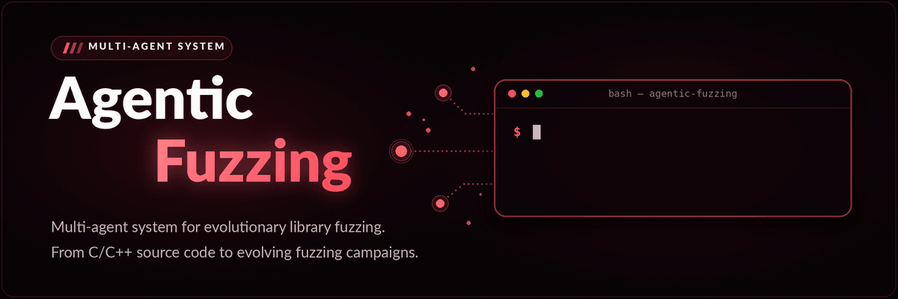
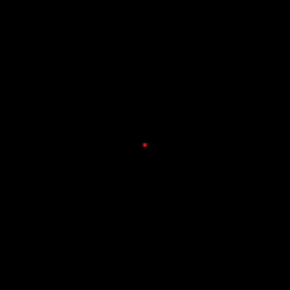
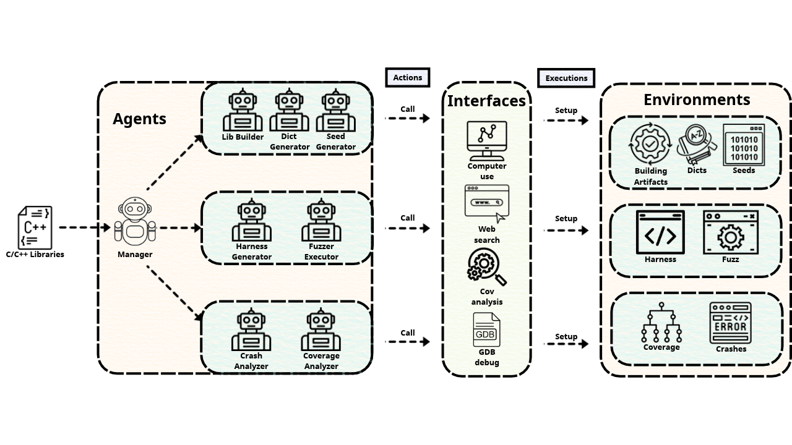

<h1 align="center">Arasaka</h1>

<p align="center">
  <strong>Multi-agent system for evolutionary libraries fuzzing</strong><br>
  From C/C++ source code to evolving fuzzing campaigns.
</p>

<p align="center">
  <a href="pyproject.toml"></a>
  <a href="#quick-start"></a>
  <a href="#benchmarks"></a>
  <a href="#"></a>
  <a href="#"></a>
  <a href="#"></a>
  <a href="LICENSE"></a>
</p>

<p align="center">
  
</p>

<p align="center">
  <a href="#quick-start"><strong>Quick Start</strong></a> ·
  <a href="#benchmarks"><strong>Benchmarks</strong></a> ·
  <a href="#results"><strong>Results</strong></a> ·
  <a href="#license"><strong>License</strong></a>
</p>

---

## Introduction

<p align="left">
  
  Arasaka is an autonomous multi-agent system for fuzzing C/C++ libraries. Starting from source code, specialized agents collaborate to prepare builds, generate harnesses and inputs, run fuzzers, and analyze coverage and crashes.
</p>
<br clear="left"/>

<p align="center">
  
</p>

## Quick Start

Tested on **Ubuntu 24.04 LTS**, using docker and an OpenAI-compatible LLM endpoint. Run the following commands from the repository root.

### 1. Build your docker

Install docker engine and the docker compose plugin using the [official guide](https://docs.docker.com/engine/install/ubuntu/), then build the image:

```bash
docker buildx build -t arasaka -f docker/Dockerfile .
```

### 2. Configure your LLM

```bash
cp .env_template .env
```

Edit `.env` with your endpoint, API key, and model:

```dotenv
OPENAI_BASE_URL=https://api.example.com/v1
OPENAI_API_KEY=your-api-key
OPENAI_MODEL=your-model
```

A GitHub token is optional. Create one at [github.com/settings/tokens](https://github.com/settings/tokens) and set `GITHUB_TOKEN` in `.env` to enable GitHub search.

### 3. Launch your fuzzing

```bash
./benchmark/run.sh cjson
```

The launcher prepares the source checkout and starts `arasaka-cjson` in the background. The default campaign runs for **24 hours**, then exports full code coverage. Source and output paths are configured automatically.

## Benchmarks

Choose a library below and use its **Target ID** with `./benchmark/run.sh <target>`. Library names link to their source repositories.

The launcher caches checkouts in `.cache/targets/<target>` and saves results in `output/<target>`. It currently clones each repository's default branch; the paper's evaluation uses the specific revisions listed in Table I.

| Library | Focus | Target ID |
| :--- | :--- | :--- |
| [c-ares](https://github.com/c-ares/c-ares) | Asynchronous DNS resolution | `c-ares` |
| [cJSON](https://github.com/DaveGamble/cJSON) | JSON parsing and serialization | `cjson` |
| [curl](https://github.com/curl/curl) | Data transfer and network protocols | `curl` |
| [libaom](https://aomedia.googlesource.com/aom) | AV1 video encoding and decoding | `libaom` |
| [libjpeg-turbo](https://github.com/libjpeg-turbo/libjpeg-turbo) | JPEG encoding and decoding | `libjpeg-turbo` |
| [liblouis](https://github.com/liblouis/liblouis) | Braille translation | `liblouis` |
| [libmagic](https://github.com/file/file) | File type identification | `libmagic` |
| [libpcap](https://github.com/the-tcpdump-group/libpcap) | Network packet capture | `libpcap` |
| [libpng](https://github.com/pnggroup/libpng) | PNG encoding and decoding | `libpng` |
| [libtiff](https://github.com/libsdl-org/libtiff) | TIFF image processing | `libtiff` |
| [libvpx](https://chromium.googlesource.com/webm/libvpx) | VP8 and VP9 video encoding and decoding | `libvpx` |
| [Little CMS](https://github.com/mm2/Little-CMS) | Color management | `lcms` |
| [OpenCV](https://github.com/opencv/opencv) | Computer vision and image processing | `opencv` |
| [OpenSSL](https://github.com/openssl/openssl) | Cryptography and TLS | `openssl` |
| [Protocol Buffers](https://github.com/protocolbuffers/protobuf) | Structured data serialization | `protobuf` |
| [pugixml](https://github.com/zeux/pugixml) | XML parsing and processing | `pugixml` |
| [RE2](https://github.com/google/re2) | Regular expression matching | `re2` |
| [SQLite](https://github.com/sqlite/sqlite) | Embedded SQL database | `sqlite` |
| [TinyGLTF](https://github.com/syoyo/tinygltf) | glTF model loading and serialization | `tinygltf` |
| [zlib](https://github.com/madler/zlib) | Data compression | `zlib` |

## Results

| Library | CVE | Target ID |
| :--- | :--- | :--- |
| [libxls](https://github.com/libxls/libxls) | | libxls |

## License

Arasaka is dual-licensed under **[AGPL-3.0-only](LICENSE)** or a separate **commercial license** obtained from the copyright holders. You can choose either option:

1. **Open-source license (AGPL-3.0-only)**. Use, modify, and share Arasaka under the AGPL's terms. If you distribute covered binaries, provide the corresponding source as required by the license. If you run a modified version as a network service, offer its corresponding source to users who interact with it remotely. Full terms: [LICENSE](LICENSE).

2. **Commercial license**. If you cannot or do not want to meet the AGPL requirements for your intended use, obtain a separately negotiated commercial license before proceeding. Contact hungnd.attt2024@gmail.com. This repository does not grant a commercial license.